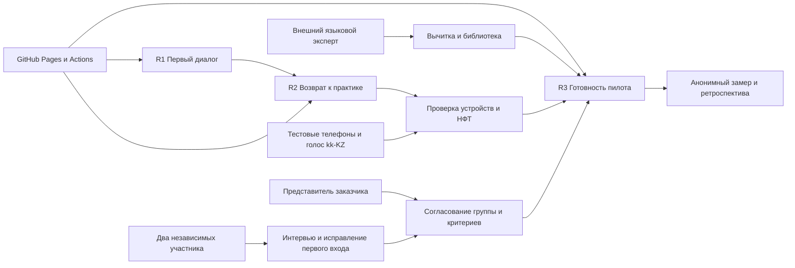

# ЛЗ 5 План поставки, зависимости и загрузка Тіл Mix

Проект выполняет один студент. План составлен на 15 учебных недель. Для связи с вероятностным прогнозом начало недели 7 условно принято за 16 ноября 2026 года. Реальные даты занятий и защиты определяет учебное расписание.

## 1 WBS до третьего уровня

Первый уровень — **1.0 Тіл Mix, работающий тренажёр и комплект артефактов семестра**. Ниже у каждой ветви второго уровня есть пакеты третьего уровня с самостоятельным результатом.

| Уровень 2 | Уровень 3 и результат |
|---|---|
| **1.1 Инициация и управление** | **1.1.1** Карточка, ADR, бизнес-кейс и устав. **1.1.2** GitHub Projects, схема изменений, выпуски. **1.1.3** Журнал решений, рисков и статусов |
| **1.2 Требования и учебный дизайн** | **1.2.1** Карта стейкхолдеров и интервью. **1.2.2** Карта историй, бэклог и приёмка. **1.2.3** Спецификация НФТ и план пилота |
| **1.3 Основные пользовательские сценарии** | **1.3.1** Адаптивный вход и маршрут A1–A2. **1.3.2** Ветвящиеся диалоги и подсказки. **1.3.3** Двуязычный словарь и сохранение прогресса |
| **1.4 Практика и повторение** | **1.4.1** Карточки с интервалами, очередь из урока и теста. **1.4.2** Выбор темы и направления теста. **1.4.3** Недельная цель, календарь и игровой прогресс |
| **1.5 Публикация и готовность пилота** | **1.5.1** Сборка, контроль версий и GitHub Pages. **1.5.2** Вычитка языка, озвучка, доступность и техническая приёмка. **1.5.3** Сопровождение пилота, новые сценарии и инструкция |
| **1.6 Оценка и завершение** | **1.6.1** Capacity, оценки и Монте-Карло. **1.6.2** Замеры до/после и решение о продолжении. **1.6.3** Ретроспектива, финальная демонстрация и портфолио |

### Словарь пяти пакетов

| Пакет | Что входит | Что проверяет готовность | Входы и ответственный |
|---|---|---|---|
| **1.2.1 Стейкхолдеры и интервью** | Матрица влияния, коммуникации, два наблюдения и выводы | Есть два разных участника, дата, факты и связь выводов с бэклогом | Заказчик/учащиеся подтверждают участие. Студент ведёт заметки |
| **1.3.2 Ветвящиеся диалоги** | Шесть историй, четыре концовки на историю, обратная связь и переключатель перевода | По тесту достижимы 24 концовки. Браузерный прогон подтверждает переход и повтор после ошибки | Данные сценариев и критерии T02. Студент реализует, эксперт вычитывает |
| **1.4.1 Карточки** | Помещение фраз в очередь, три оценки, актуальная дата и сохранение | Тесты подтверждают сроки 1/3/7/14/30 дней. Карточка не теряется после перезагрузки | Словарь T04, хранилище T03. Студент |
| **1.5.2 Готовность пилота** | Язык, мобильные устройства, клавиатура, проверка критериев НФТ | Приняты T09, T10, T17 и нет блокирующих дефектов | Вычитка, проверка браузеров и доступность тестовых устройств. Студент, внешний эксперт подтверждает язык |
| **1.6.1 Прогноз сроков** | Снимок исходных данных, 10 000 прогонов, перцентили, графики и слайд | Тот же JSON и seed воспроизводят P50, P70, P85 и P95, срез совпадает с трекером | Данные throughput и 10 оценённых историй. Студент |

## 2 Три инкремента и контрольные точки

| Инкремент | Цель и содержимое | Веха | Подтверждение |
|---|---|---|---|
| **R1 Ветка разговора** | Учащийся открывает сайт и самостоятельно проходит одну историю. Включает шесть историй, перевод, подсказки, базовый тест и словарь | Учебные недели 1–3, выпуск подтверждён по истории репозитория | Урок доступен по Pages, открывается одна из 24 концовок, состояние переживает перезагрузку |
| **R2 Возврат к практике** | С первого экрана перейти к следующему уроку, повторить ошибку, увидеть недельную цель. Маршрут, тематический/обратный тест, интервалы и календарь | Недели 4–6, технический инкремент | Тесты расписания, переходов и фильтра. Браузерный прогон очереди, теста и адаптивного вида |
| **R3 Пилот** | Провести короткое занятие, собрать анонимные замеры и решить, развивать ли продукт. Восемь историй работ T09–T12, T14, T16–T18. T13/T15 остаются в бэклоге | Недели 7–15, при наличии внешних подтверждений | Два наблюдения, вычитка, проверка устройств и клавиатуры, памятка, согласованный пилот и итоги либо документированный статус ожидания |

Публикация. Изменения проходят тест и сборку в GitHub Actions перед публикацией `main`. Формат локального прогресса сохраняет обратную совместимость. При ошибке поставки определить последний успешный коммит, восстановить рабочую версию через отменяющий коммит и повторить проверку. Реальный пилот начинается после допуска языка и группы. До допуска сайт используется как демонстрация.

## 3 Карта зависимостей

| Внешняя зависимость | Владелец подтверждения | Дата или контрольная точка | Статус и реакция |
|---|---|---|---|
| Языковая вычитка | Студент запрашивает, преподаватель казахского подтверждает | План 29 ноября 2026 | Ожидает. Сузить демонстрационный срез до вычитанных историй, пилот с непроверенным языком не проводить |
| Два участника для интервью | Студент договаривается, каждый участник соглашается сам | План 29 ноября 2026 | Ожидает. При недоступности согласовать другие интервью, пометить гипотезы неизмеренными |
| Доступ к Android/iOS и голосу | Студент организует устройства, владелец даёт доступ к тесту | План 6 декабря 2026 | Частично проверен браузер. Для каждого телефона записать версию, язык и результат |
| Согласие на учебный пилот | Представитель языкового центра/преподаватель | План 13 декабря 2026 | Ожидает. При отсутствии согласия показать техническое демо и вынести замер на отдельный срок |
| Публикация Pages | Студент проверяет URL и Actions, инфраструктура GitHub | HTTP 200 подтверждён 15 ноября 2026, повтор после релиза | При сбое проверить артефакт сборки и использовать локальное демо |

Зависимая цепочка R3 — вычитка и пользовательские интервью, правки, проверка устройств и согласование, затем пилот и замер. У каждого внешнего шага отдельно фиксируется ожидание. В оценку собственных часов ожидание не включено. Если подтверждение задерживается, дата пилота меняется независимо от готовности кода.

## 4 Топология и RACI

Один студент владеет потоком от требований до релиза. GitHub предоставляет платформенные возможности. Эксперт помогает с языковым качеством, представитель заказчика отвечает за допуск. Выделенных платформенной, тестовой и редакторской команд нет. Ограничение незавершённой работы — **одна активная история**. Пока внешняя проверка висит в In review, можно взять готовую независимую историю.

Обозначения: **R** выполняет, **A** утверждает и отвечает за результат, **C** консультирует, **I** получает информацию. У каждого результата одна роль A. Назначение ролей внешним людям остаётся планом до согласия.

| Артефакт | Студент | Эксперт по казахскому | Заказчик пилота | Преподаватель курса | Учащиеся |
|---|---|---|---|---|---|
| Устав, ADR и прогноз разработки | R/A | C | C | I | — |
| Карта историй и бэклог | R/A | C | C | I | C |
| Проверенные формулировки | R | A | I | — | C |
| Тесты, сборка и выкладка | R/A | I | I | — | — |
| Допуск и критерии пилота | R | C | A | I | C |
| Проверка учебного портфолио | R | — | I | A | — |
| Анонимные итоги пилота | R | C | A | I | C |

## 5 Capacity одного исполнителя

Это плановое допущение до сверки личного расписания. Номинально выделяется 8 часов в обычную неделю, исходя из двух вечерних слотов по 2 часа и одного блока 4 часа. В две условно напряжённые недели оставлено по 4 часа. На оформление и коммуникации уходит 1 час в неделю. Резерв округляется до целого часа.

| Расчёт | Семестр, 15 недель | Остаток, недели 7–15 |
|---|---:|---:|
| Номинальные часы | 120 | 72 |
| Сокращение из-за двух напряжённых недель | −8 | −8 |
| Фактически доступные часы | 112 | 64 |
| Координация и отчётность | −15 | −9 |
| Резерв ~15% от оставшихся часов | −15 | −8 |
| **Планируемая работа** | **82** | **47** |

Инкременты: ориентир 16 ч на R1, 19 ч на R2 и 47 ч на R3. Это распределение лимита, а не журнал потраченных часов. В одном расписании не параллелить разработку и подготовку большого артефакта в одном рабочем слоте.

Очередь из десяти историй требует 62 ч. Срез пилота из восьми историй требует 43 ч. Резерв внутри планового лимита 47 ч — ещё 4 ч. T13 и T15 отложены, так как суммарно занимают 19 ч и не блокируют пилот. Оценки пересматриваются после каждого фактического выпуска. Сравнение срока при разном объёме — в [ЛЗ 6](lab-06.md).

## 6 Правило контроля

Раз в неделю записать фактические часы, закрытые истории и внешние ожидания. Если фактический бюджет уменьшается более чем на 4 часа, уменьшить срез или пересогласовать контрольную точку. Если меняется язык или порядок пилота, обновить соответствующее issue, а затем WBS и план релизов. Codex помог подготовить структуру, а план нагрузки остаётся явно помеченным допущением.
